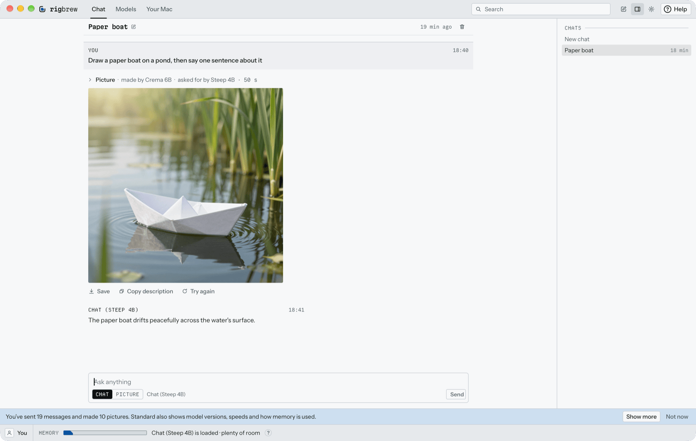
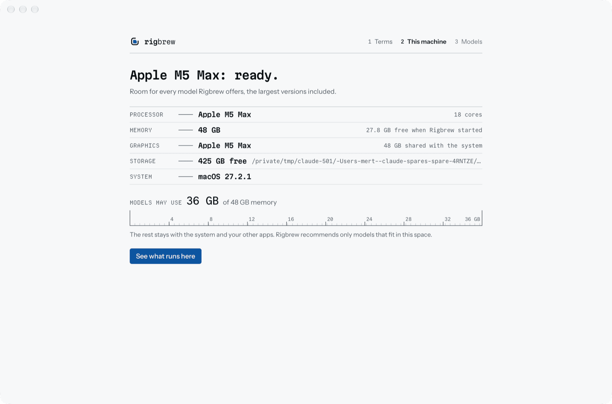
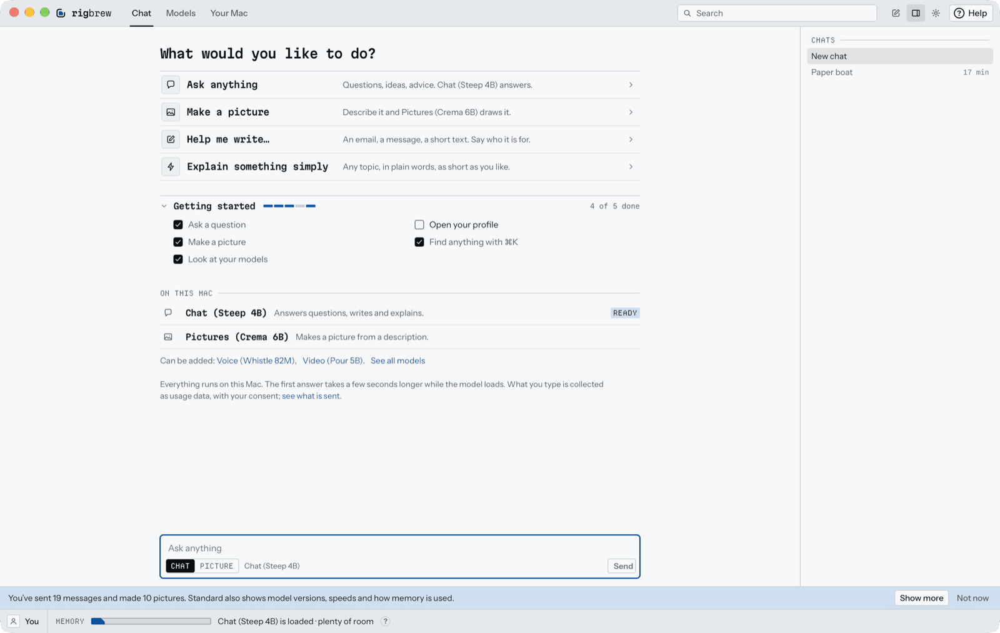
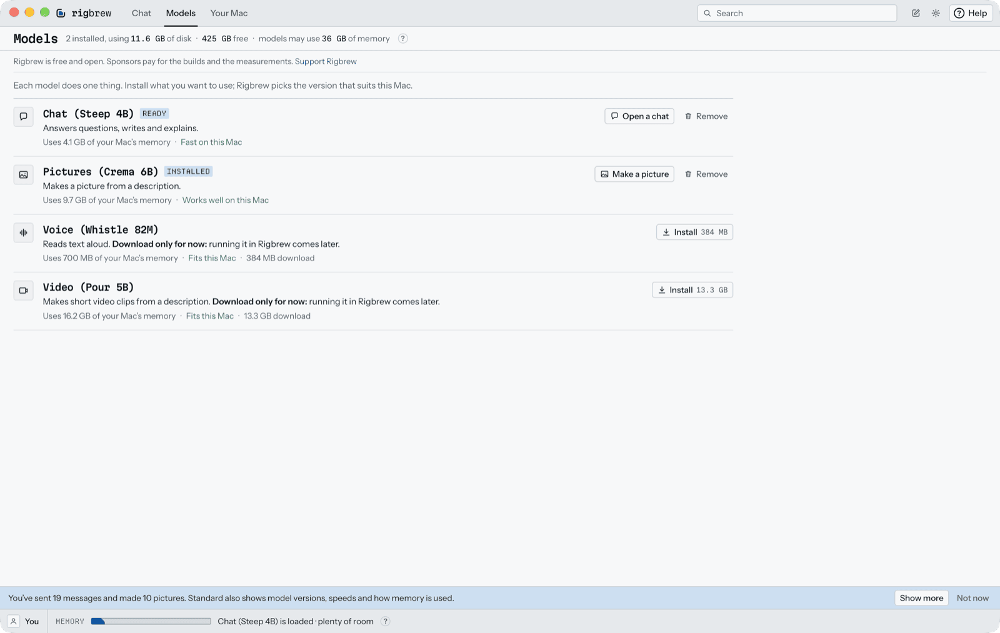
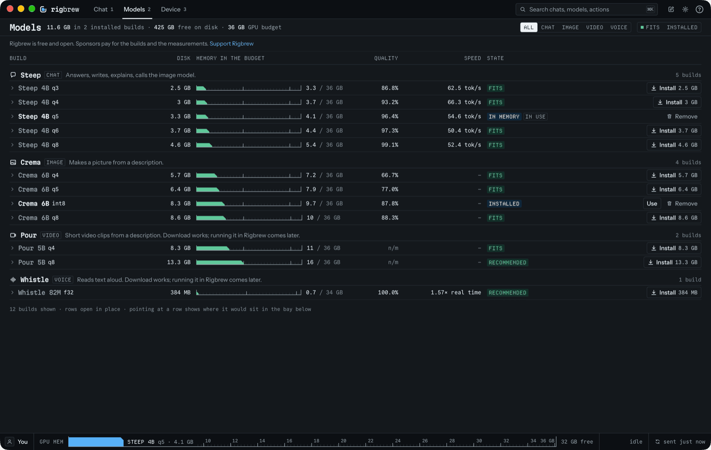
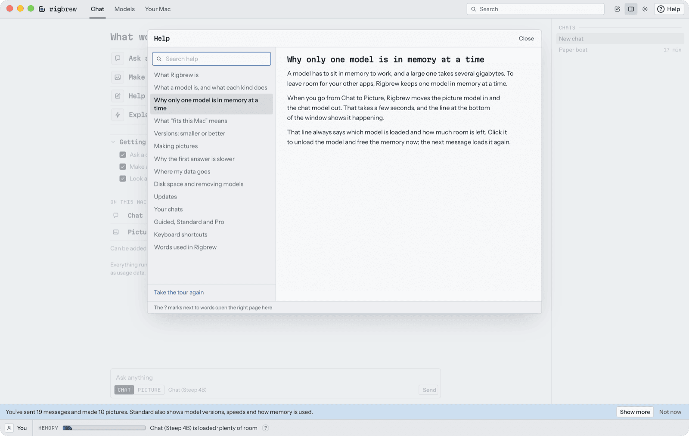
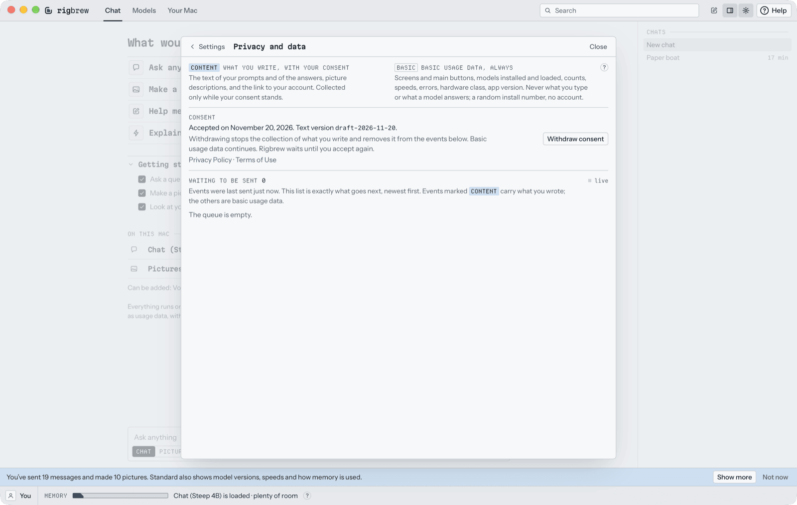
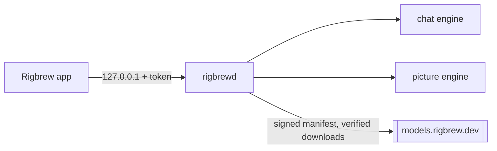

<p align="center">
  <picture>
    <source media="(prefers-color-scheme: dark)" srcset="docs/brand/mark-dark.svg">
    
  </picture>
</p>

<h1 align="center">rigbrew</h1>

<p align="center">
  <strong>Open models, fitted to your rig.</strong><br>
  Chat, pictures and voice today, video next, all running on your own computer.
</p>

<p align="center">
  <a href="https://rigbrew.dev">rigbrew.dev</a> ·
  <a href="#build-from-source">Build from source</a> ·
  <a href="docs/models.md">Models</a> ·
  <a href="ROADMAP.md">Roadmap</a> ·
  <a href="https://github.com/sponsors/mgolcu00">Sponsor</a>
</p>

<p align="center">
  <a href="https://github.com/mgolcu00/rigbrew/actions/workflows/ci.yml"></a>
  <a href="LICENSE"></a>
  
  
</p>

<p align="center">
  <picture>
    <source media="(prefers-color-scheme: dark)" srcset="docs/media/standard-transcript-dark-900.png">
    
  </picture>
</p>

Rigbrew looks at your computer, tells you which open AI models will actually run on it, downloads a version that
was made and **measured** for machines like yours, and runs it locally. No account needed, no usage limits, and
your prompts never go to a model provider.

> **Status: early.** Rigbrew runs on macOS with Apple silicon, built from source. A signed macOS beta is next,
> then Windows. Nothing is published for download yet.

## Why

Running a model locally today means reading model cards, guessing between `Q4_K_M` and `Q5_K_S`, and finding out
it does not fit after a 9 GB download. Rigbrew does that work once, properly, for everyone:

- **It knows your machine.** It reads the processor, memory and graphics, and works out how much memory a model
  may use without slowing everything else down.
- **It picks for you.** For every model it chooses the lightest version whose measured quality is good enough and
  that fits, and it says why.
- **It shows its numbers.** Every version is compared with the original before it ships. You see how close it is
  and how fast it runs, not adjectives.
- **It is one app.** Chat, pictures and voice, and soon video, in one conversation. Ask for a picture in the chat
  and the chat model asks the picture model; press Read aloud and an answer is spoken.

## A look inside

<table>
  <tr>
    <td width="50%"><br><sub><b>First launch.</b> Rigbrew reads the machine and shows how much memory models may use.</sub></td>
    <td width="50%"><br><sub><b>Guided.</b> Plain words, starting points, a checklist that ticks itself.</sub></td>
  </tr>
  <tr>
    <td><br><sub><b>Models, Guided.</b> One row and one button per model.</sub></td>
    <td><br><sub><b>Models, Pro.</b> Every version, its memory, measured quality and speed.</sub></td>
  </tr>
  <tr>
    <td><br><sub><b>Help.</b> Short answers, a glossary, and a tour you can replay.</sub></td>
    <td><br><sub><b>Privacy and data.</b> Every event waiting to be sent, before it is sent.</sub></td>
  </tr>
</table>

The interface grows with you: **Guided** for people who have never run a model, **Standard** with versions and
speeds, **Pro** with every build, raw ids and keyboard shortcuts. Rigbrew suggests the next level when you are
ready and never switches by itself.

## Model families

| Family | Does | First package | Status |
|---|---|---|---|
| **Steep** | Chat, writing, explaining; can call the other families | Steep 4B | Runs |
| **Crema** | Pictures from a description | Crema 6B | Runs |
| **Pour** | Short video clips | Pour 5B | Download only, running it comes next |
| **Whistle** | Reading answers aloud, in English | Whistle 82M | Runs |
| **Sift** | Speech to text | — | Planned |

Only models under Apache-2.0, MIT or CC-BY-4.0 are packaged. More in [docs/models.md](docs/models.md).

## Measured, not promised

Every version is compared with the full-precision original on the same inputs. For the chat family:

| Version | Download | KL divergence ↓ | Same next token ↑ | Speed on M5 Max |
|---|---|---|---|---|
| Best quality | 4.6 GB | 0.0005 | 99.1% | 52 tok/s |
| Better | 3.7 GB | 0.0026 | 97.3% | 50 tok/s |
| Balanced | 3.3 GB | 0.0066 | 96.4% | 55 tok/s |
| Small | 3.0 GB | 0.0202 | 93.2% | 66 tok/s |
| Smallest | 2.5 GB | 0.0819 | 86.9% | 63 tok/s |

On a machine with room for all of them, Rigbrew picks *Balanced*: the lightest version that keeps the next token
the same 96% of the time.

## How it works



The app is a Tauri window. A small local service, `rigbrewd`, scans the machine, downloads and checks packages,
and runs the engines ([llama.cpp](https://github.com/ggml-org/llama.cpp),
[stable-diffusion.cpp](https://github.com/leejet/stable-diffusion.cpp)) as child processes on loopback. The list
of packages is signed; every file is checked byte for byte. Its chat endpoint is OpenAI-compatible, so your own
tools can use the models too: see [the local API](docs/api.md). Details in [docs/architecture.md](docs/architecture.md).

## Privacy

Models run on your machine and prompts are never sent to a model provider. Rigbrew does send usage data to its
own server, in two layers:

- **Basic usage, always:** what was opened, installed and run, how fast, errors, hardware class, app version and a
  random install id. Never what you type or what a model answers, no account, no stored IP address.
- **Content, only with your consent and an account:** the text of prompts and answers, to improve the builds.
  **Builds from this repository have no account module and never send content.**

The app shows every event waiting to be sent. `DO_NOT_TRACK=1` turns off every upload. The code is short:
[`core/src/events.rs`](core/src/events.rs), [`daemon/src/cloud.rs`](daemon/src/cloud.rs).

## Build from source

macOS 14 or later on Apple silicon. You need [Rust](https://rustup.rs), Node 22 or later and
[pnpm](https://pnpm.io).

```sh
git clone https://github.com/mgolcu00/rigbrew && cd rigbrew
cargo build -p rigbrewd
cd app && pnpm install
RIGBREW_DAEMON=$PWD/../target/debug/rigbrewd pnpm tauri dev
```

The app starts its service, which loads the signed manifest from `models.rigbrew.dev` and downloads what a model
needs the first time you use it. From a terminal, without the app:

```sh
cargo run -p rigbrew -- scan                                   # what Rigbrew sees on this machine
cargo run -p rigbrewd                                          # the local service
```

More in [app/README.md](app/README.md) and [docs/api.md](docs/api.md#environment).

## Repository

| Path | What |
|---|---|
| [`app/`](app) | The desktop app: Tauri 2, SvelteKit, TypeScript |
| [`core/`](core) | Rust library: hardware scan, selector, signed manifest, downloader, engines, event queue, chats |
| [`daemon/`](daemon) | `rigbrewd`, the local HTTP service |
| [`cli/`](cli) | `rigbrew` on the command line |
| [`docs/`](docs) | Architecture, the local API, models, brand, legal texts |

## Contributing

Bug reports with your hardware, measurements from your machine and small pull requests are the most useful things
right now. Read [CONTRIBUTING.md](CONTRIBUTING.md) and the [roadmap](ROADMAP.md). Security issues: [SECURITY.md](SECURITY.md).

## Sponsors

Rigbrew is free and open. Building, measuring and hosting the model packages costs real hardware and bandwidth.
If Rigbrew is useful to you, [sponsor it on GitHub](https://github.com/sponsors/mgolcu00); sponsors are listed on
[rigbrew.dev](https://rigbrew.dev/#sponsor).

## Licence

The code is under [Apache-2.0](LICENSE). Model packages keep the licence of the model they are built from and ship
their own `LICENSE` and `NOTICE`. Third-party software and fonts: [NOTICE](NOTICE). Rigbrew is not affiliated with
the authors of the models it packages.
