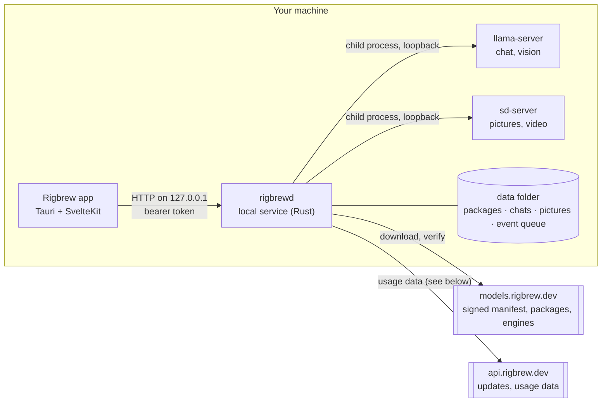

# Architecture

Rigbrew is three programs on your machine and two services on the internet.

## Programs

| Part | Language | What it does |
|---|---|---|
| [`core/`](../core) | Rust library | Hardware scan, hardware classes and memory budgets, the signed manifest, the variant selector, the resumable verified downloader, engine installation and supervision, the local event queue, saved chats. |
| [`daemon/`](../daemon) | Rust (axum) | `rigbrewd`: the local HTTP API the app uses ([`api.md`](api.md)). Loads one engine at a time, proxies chat, saves pictures, sends usage data. |
| [`cli/`](../cli) | Rust | `rigbrew`: `scan`, `recommend`, `pull`, `chat` from a terminal. |
| [`app/`](../app) | Tauri 2, SvelteKit, TypeScript | The window. Starts and supervises `rigbrewd`, restarts it if it dies; the service exits if the app does. |

Engines are not part of this repository: [llama.cpp](https://github.com/ggml-org/llama.cpp) and
[stable-diffusion.cpp](https://github.com/leejet/stable-diffusion.cpp) builds are downloaded per platform from the
signed manifest.

## Choosing a model for a machine

1. **Scan.** CPU features, memory, GPU and its memory, free disk ([`core/src/hardware`](../core/src/hardware)).
2. **Budget.** A model never gets all of the memory. On a separate graphics card the budget is its memory minus 10%
   (at least 700 MB); with unified memory it is two thirds of memory up to 16 GB and three quarters above, leaving
   at least 4 GB to the system ([`tier.rs`](../core/src/hardware/tier.rs)).
3. **Select.** Among the versions that fit the budget on a backend the machine has, take the lightest one whose
   measured quality reaches the package's bar; if none does, the best one that fits; prefer the GPU over the CPU
   ([`select.rs`](../core/src/select.rs)). The answer comes with its reason, which the app shows.

## Trust

- The manifest is signed (minisign, Ed25519). The key is compiled in. Unsigned or changed manifests are refused in
  release builds.
- Every downloaded file is checked against the size and sha256 in the manifest before it is used; interrupted
  downloads resume and are checked again.
- Engine archives are unpacked as plain files only; links and paths that climb out of the folder are refused.
- `rigbrewd` and the engines listen on loopback only. `rigbrewd` needs a random token that only the app can read
  (`daemon.json`, mode `0600`); the data folder is `0700`.
- Usage data is described in [`api.md`](api.md#what-leaves-the-machine). Builds from this repository never send
  prompts or answers.

## Data folder

| Path | What |
|---|---|
| `packages/` | Installed model files, by package and version. |
| `engines/` | Engine programs, by engine, version and platform. |
| `images/` | Generated pictures (`<id>.png`). |
| `chats.db` | Saved conversations (SQLite). |
| `events.db` | Usage events waiting to be sent, and the consent state (SQLite). |
| `state/` | Interrupted downloads to resume, the last verified manifest, cached app config. |
| `daemon.json` | Port and token of the running service. |
